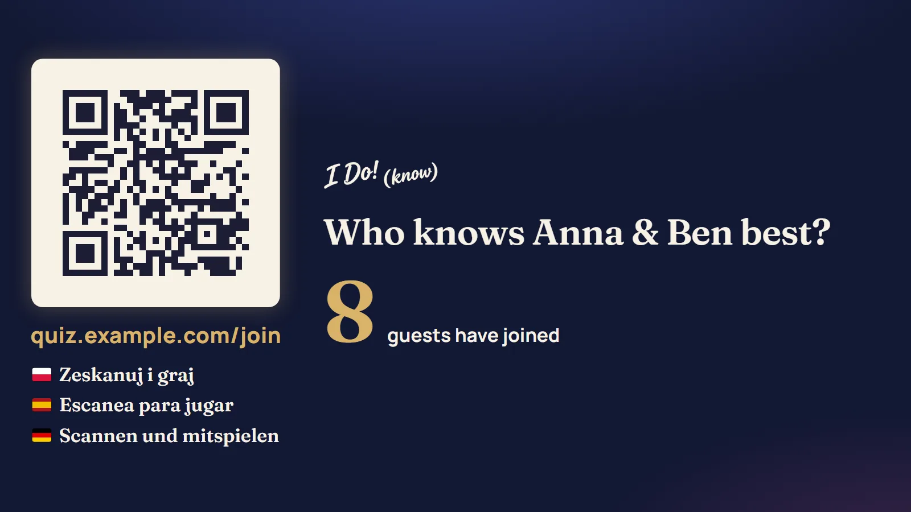
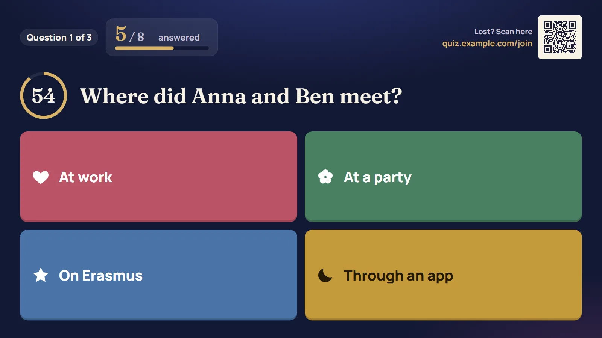
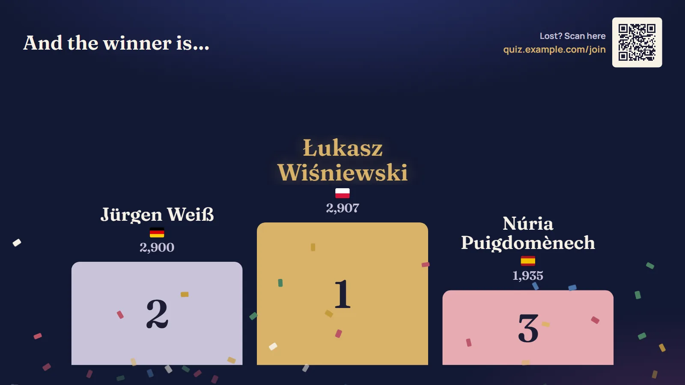
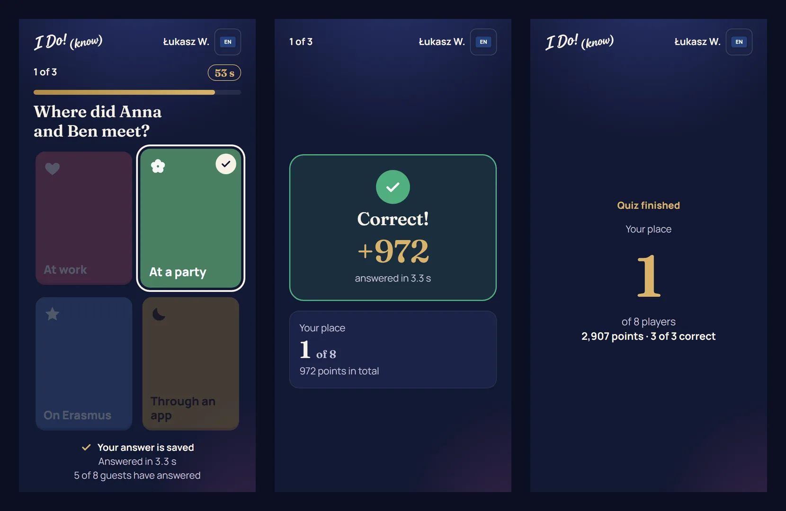
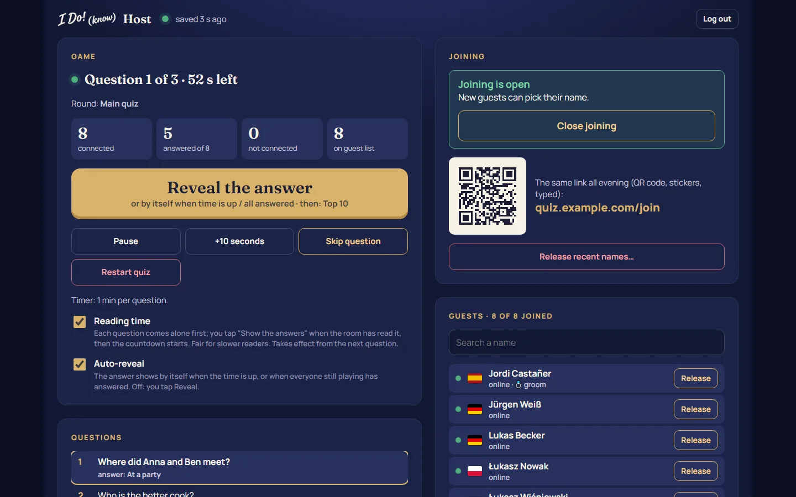

# I Do! (know)

A live "Who knows the couple best?" wedding quiz (Kahoot-style); a "collect the other family" wristband game is a possible later feature. Guests play in their phone's browser. There is nothing to install. Built for a real wedding with about 100 guests from three countries, in five languages (PL, ES, CA, DE, EN).

Much of the code was written with Claude (Anthropic's AI) under my direction: I planned the phases, made the decisions and tested every step.

The couple is not hard-coded: their names and the quiz title come from `content/event.json` (see `content/event.example.json`), so the same app works for any wedding.

## Screenshots

All screenshots use the example content (a made-up couple and guests) from a full test game with 8 simulated phones.

**Big screen** (the projector): guests scan the QR code to join, then follow every question, the votes, the Top 10 and the podium.





**Phones**: answering, the result after the reveal, and the final place.



**Host panel**: one big button for the next step, the joining switch, the guest list and the question list.



Status: the quiz is built (collect mode and LED wristbands are shelved as possible later features). The manual test plan is `docs/TESTING.md`. The guest's phone (language, name, waiting room, warm-up round, questions, reveal, rank, final) and the big screen (join QR, questions, votes, top 10, podium) are built, in five languages. Admin login, the fixed join link (`/join`) with an open/closed switch, guest sessions, name search and claiming, the quiz over Socket.IO and snapshots work. The host panel runs the quiz (one big "next" button, confirmations, guests, joining switch, one timer for all questions, screen language) and edits the questions. Finished games are archived (`data/games`) for the host to go through, download (CSV/JSON) and show on the big screen. The answer is revealed by itself when the time is up or every active player has answered (switchable), and after the podium everyone's place is shown on the big screen (scrolling in a loop) and on every phone. The host can make named question sets and play them as extra rounds, with an overall ranking across rounds; between questions every phone shows its own place with 3 places above and below. `npm run texts:export` / `texts:import` make the translation review sheets. Each question can open with reading time (the host shows the answers), and the bride and groom can play along off the leaderboard, with their answers reviewed on the big screen at the end.

## Public demo

With `DEMO_MODE=true` the same app runs as a public demo: the example couple and guests, the password and one-tap logins on the login page, **demo players** (the host panel adds 8 players who join and answer by themselves, so one person on a laptop sees the whole game), no photo uploads, and a fresh start every night at 04:00. It never reads or writes the real content files.

The real wedding runs on the **same address**: logging in with the separate event password (`EVENT_PASSWORD`) checks the real content in `event/content`, then restarts the server as the event (the real title, guests and questions, its own saved games in `event/data`, joining closed, no demo features, the demo password refused). Only one game ever runs at a time, so demo visitors and wedding guests never share one. "End the event" in the host panel restarts it as the demo; the event's data stays.

## Structure

```
apps/client      React + Vite: /screen (big screen), /play (phone), /host (host panel)
apps/server      Fastify + Socket.IO (in production it also serves the built client)
packages/shared  Shared types and Socket.IO event definitions
content/         Questions, guest list, photos. Only *.example.json files are in git.
scripts/         Helper scripts (e.g. wristband QR generator, later)
tests/           e2e (Playwright: real browsers) and load (200+ simulated guests)
```

## Requirements

- Node.js 24 or newer
- npm 11

## Run locally

First create `.env` from `.env.example` and fill in `ADMIN_PASSWORD` and `SESSION_SECRET`: the server refuses to start without them.

```powershell
Copy-Item .env.example .env   # then edit .env
npm install
npm run dev
```

- Open http://localhost:5173/host and log in (at http://localhost:5173/login) with `ADMIN_PASSWORD`. Open joining in the host panel (Joining), then open http://localhost:5173/join in a private window to be a guest on /play.
- The server runs on http://127.0.0.1:3210 (health check: `/health`). Vite forwards `/socket.io`, `/login`, `/logout`, `/join`, `/photos/` and the host's photo uploads and game downloads to it.
- In development only the server is protected: the Vite pages open without a login, but their Socket.IO connection is refused.

## Production build (local test)

```powershell
npm run build
npm start
```

Then open http://localhost:3210/host. Fastify serves the built client and Socket.IO on one port, and the whole site is closed: without the admin login or a guest session every page goes to the login (guests: the bare domain and `/play` lead to `/join`).

## Access

- **Admin** (`/host`, `/screen`): log in at `/login` with `ADMIN_PASSWORD`. Changing the password logs out every admin device.
- **Guests** (`/play`): open the join link `<domain>/join` (the QR code; the same link all evening, also on stickers and as text on the big screen). The device gets a guest session cookie, so it reconnects later without the QR code. New guests can pick a name only while the host has **joining open** (it starts closed; closed, phones see "You're a bit early" and go on by themselves once it opens). Guests who already joined always stay in.
- The guest picks a language, searches their name (accents don't matter: "lukasz" finds "Łukasz") and confirms it: the name is locked to that device. Until the quiz starts the guest can give it back ("Not you? Change name"); after that the host can release it. The host can also add a missing guest.
- **Big screen** (`/screen`, on the laptop connected to the projector): press **F** (or the button in the corner) for full screen; the mouse pointer hides after 3 seconds. It shows the join QR code and the link as text (or "Joining opens soon" while joining is closed), then each question with a countdown, how the room voted, the top 10 and the podium. The host picks its language (English by default) and reveals the podium place by place (3rd, 2nd, 1st); the phones show their final place only after that. The QR code uses the address the screen was opened with, so open it with the address guests can reach (not `localhost`: the screen warns then).
- **Timer:** one countdown for every question (default 60 s, 10–300 s), set in the host panel in the waiting room and saved in `questions.json` (`timeLimitSec`). Points go from 1000 (answered at once) to 500 (at the last second); 0 only for a wrong or missing answer.
- Before the quiz the host can play a **warm-up round** (the `warmup` questions in `questions.json`) as often as needed: it shows everyone how it works, and its points never count.
- The guest list is `content/guests.json` (see `content/guests.example.json` for the format; the example is used while the real file is missing).
- The game is saved to `data/snapshot.json` after every change. After a restart the game continues where it was and phones reconnect by themselves. A snapshot that can't be used is kept as `data/snapshot.rejected-<time>.json`, the save before it (`snapshot.prev.json`) is tried, and the host panel shows a warning. If only `questions.json` changed, only the quiz restarts; guests, collect mode and the joining switch stay.
- To restore a kept file by hand: stop the server, copy it over `data/snapshot.json`, start again.
- To reset the game completely: stop the server and delete the whole `data/` folder. Deleting only `snapshot.json` is not enough: the server then restores `snapshot.prev.json`.

## Testing on a real phone (same Wi-Fi as the PC)

```powershell
ipconfig                       # note the PC's IPv4 address, e.g. 192.168.1.23
npm run build
$env:HOST = "0.0.0.0"; npm start   # only for this PowerShell window
```

Windows asks whether Node may use the network: allow it for **private** networks. On the PC, open `http://<IPv4>:3210/host` (not 127.0.0.1, so the join link shows the right address), log in, open joining, and open `http://<IPv4>:3210/join` on the phone. For the big screen, open `http://<IPv4>:3210/screen` in a second window and scan its QR code with the phone. Close the PowerShell window afterwards (the server then listens only on this PC again).

## Quality checks

```powershell
npm run check      # format check + lint + typecheck + 339 unit and integration tests
npm run test:e2e   # builds, then a whole game in real browsers (Playwright)
npm run test:load  # 200 simulated guests play a whole game (LOAD_GUESTS=500 for more)
npm run format     # auto-format with Prettier
```

- **Browser tests** (`tests/e2e`): the host panel, the big screen and four phones in Chromium play a whole game: login protection, joining closed then opened, one phone on a slow mobile connection (400 ms, ~400 kbit/s), one phone losing its signal mid-question and one reloading the page (both keep their name and answer), the photo question fitting a 360×560 screen without scrolling, the podium and every phone's final place.
- **Load test** (`tests/load`): every simulated guest has its own address, opens the join link, finds and claims its name and answers every question after a human-like delay. Measured on a laptop: 200 guests joined in 0.3 s, no answer lost, and every new screen reached **every** phone within 15 ms; with 500 guests within 70 ms. Both tests start their own server with the example content only.

## Deployment

One Docker container behind a reverse proxy (Nginx Proxy Manager with Let's Encrypt): `Dockerfile` (two stages, Node 24, runs as an unprivileged user, health check on `/health`), `docker-compose.yml` (no published port: only the proxy network reaches it, so `TRUST_PROXY=true` is safe and the per-IP limits see the guests' real addresses; `restart: unless-stopped`). Deploys are a `git push` to a bare repo on the server whose `post-receive` hook (`deploy/post-receive`) checks the code out, builds, restarts, waits for the health check and prunes old images. Secrets live only in the server's `.env`; the image holds the example content only (`.dockerignore`). The proxy host needs **Websockets Support** on (Socket.IO).

## Private data

The following files are git-ignored and uploaded to the server by hand. They are never committed:

- `.env`
- `content/event.json` (the couple's names and the quiz title)
- `content/guests.json`
- `content/questions.json`
- `content/photos/*`
- `data/` (game snapshots: they hold the names picked and everyone's answers)
